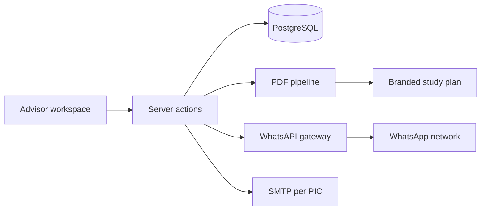

Private client work. Source and client data are not public. This is the outline I can share.

## The Problem

The admissions team was running a postgraduate pipeline across spreadsheets, email threads, paper forms, and a folder of document templates. Every study plan, cover letter, and portfolio document was assembled by hand. The work was repetitive, easy to get wrong, and hard to hand over when someone was away.

## What I Built

A single admissions platform that owns the workflow from lead to document:

- Lead pipeline with stages, ownership, and communication history.
- Role-based access for advisors, admin, and the people who should not see everything.
- Document automation that generates branded PDFs with cover letters, tables of contents, and module breakdowns.
- WhatsApp automation for follow-ups, study plan delivery, and inbound lead capture.
- Commission tracking and the reporting bits that keep the business side honest.
- A Go-based WhatsApp gateway under the hood, so messaging and calls are part of the system instead of a browser tab.

The APEL.A portfolio side grew into its own portal: [APEL.A Admissions Portal](/projects/apela/).

## The Result

The team works from one system instead of five disconnected ones. Documents that used to be assembled by hand are generated from the same data that drives the pipeline. The repetitive parts are automated, the handover is easier, and the advisors can spend their time on people instead of copy-paste.

Programme variation is data, not code: MBA, MIM, MEdu, and RPEL each carry their own durations and fee structures, so an admin adds a programme, majoring, or intake without waiting for a deploy.

## Stack

Next.js, TypeScript, Drizzle, PostgreSQL, Puppeteer, and a Go WhatsApp gateway.

## Architecture

## Notes

This is private client work, so there is no public repository or demo. The architecture and the operational details are available in a conversation, not in a screenshot.
