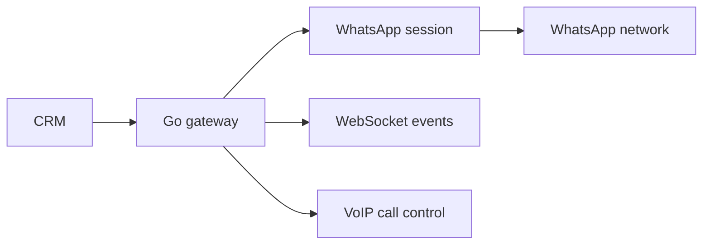

Private project. Source is not public. This is the outline I can share.

## The Problem

The CRM needed WhatsApp messaging and calling without paying a third-party SaaS for every seat, every message, and every feature that should have been a webhook. The automation also needed to live close to the CRM, not in a vendor's dashboard with its own ideas about data ownership.

## What I Built

A Go service that behaves like a proper gateway:

- WhatsApp messaging, including the boring parts: sessions, reconnects, delivery state, and errors that do not lie about success.
- VoIP call handling and real-time events over WebSocket.
- A small HTTP surface that the CRM can call without knowing anything about the WhatsApp protocol.
- Docker deployment with a footprint small enough to run next to the rest of the stack.
- Persistent session handling, because re-pairing a device every morning is not a feature.

## The Result

The CRM can send follow-ups, deliver documents, capture inbound leads, and handle calls without depending on a third-party automation platform. The gateway is one service with one job, which makes it much easier to debug when WhatsApp changes something on a Tuesday.

## Stack

Go, whatsmeow, Docker, WebSocket.

## Architecture

## Notes

This is private work, so there is no public repository. The interesting engineering is in the session lifecycle and the event model, both of which are described in the [phone calls post](/blog/go-phone-calls-whatsapi/).
